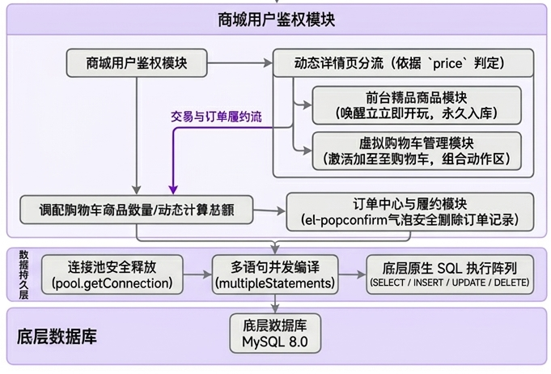
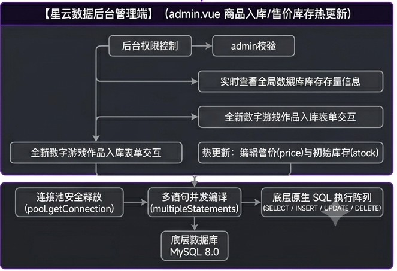

# Nebula Store 游戏商城

> **这是一个练手项目，不是一个能上线的商城。**
> 代码用于课程实训与自我练习，页面上的品牌故事、运营数据和商品文案基本都是编的，请勿当作真实业务。

## 这个项目是什么，不是什么

大二下学期的全栈实训作业。我用 Vue 3 + Express + MySQL 把「浏览商品 → 加入购物车 → 下单 → 查看订单」这条主链路完整写了一遍，中间也练了权限控制、数据库事务、并发扣库存和自动化测试。它能跑、能演示，代码是自己一行行敲出来的，但离真正的商业系统还很远——没有真实支付，没有物流和客服，也没有运维。

为了避免误会，几点先说清楚：

- **内容大多是虚构的。** 平台背景、发展历程、宣传文案、服务能力描述以及大部分商品信息，都是为页面效果编写的，不代表真实经营情况、对外承诺或已经实现的技术能力。实际情况请以代码和下面的功能列表为准。
- **不涉及真实交易。** 商品价格、库存、订单和领取记录都是模拟数据，用于跑通业务流程；支付页面只是交互演示，没有接入任何支付渠道，也不会发货、退款或提供游戏下载、启动服务。
- **素材版权不归我。** 页面中出现的第三方游戏名称、图片和品牌标识仅用于学习演示，不代表本项目与相关权利方存在合作、授权销售或背书关系，权利归各自所有者。如果权利人不希望被这样使用，联系我删除即可。
- **请不要填真实信息。** 建议在本地或隔离环境中使用演示账号和测试数据，不要输入真实的个人信息或支付信息。如果想拿这份代码做别的事，业务逻辑、安全策略、测试与部署方案都需要重新设计，素材授权也要另行确认。

说白了，**这是一份学习记录，不是一个可以直接使用的产品。** 如果它恰好对同样在学全栈的同学有点参考价值，那它就完成了自己的使命。

---

项目本体是 Vue 3 + Express 4 + MySQL 8 的全栈实现，另外附带一套可跑的自动化测试与数据一致性校验。

前台支持浏览、筛选、加购、下单、查订单；后台支持商品增删改与上下架。

> 2026-10-22 更新：订单快照、下单幂等、库存并发保护、统一账号鉴权和免费游戏库已实现。已有数据库的迁移步骤及接口变化见 [优化说明](优化说明.md)。




---

## 技术栈

| 层 | 技术 |
|---|---|
| 前端 | Vue 3 · Vite · Vue Router · Pinia · Element Plus · Axios |
| 后端 | Node.js · Express 4 · express-jwt · jsonwebtoken · bcrypt |
| 数据库 | MySQL 8.0（8 张表，连接池 + 事务） |
| 测试 | Jest（单元） · 自建回归脚本（接口 + 数据库断言） |

---

## 功能

**前台**

- 首页轮播图 + 商品分页列表，支持分类筛选与价格上限筛选
- 免费开玩专区（`maxPrice=0` 复用同一套列表接口）
- 商品详情、加入购物车、购物车数量调整与删除
- 下单结算（服务端计价）、订单列表、订单详情、订单软删除

**后台**（需管理员）

- 商品列表（含已下架）、新增、局部更新、软删除、上下架

**账号体系**

- 注册（前后端双重校验）、登录（bcrypt 校验）、JWT 鉴权
- 角色区分：`role=1` 管理员 / `role=0` 普通用户
- 账号冻结（`status=0`）

---

## 架构

```
浏览器
  │  /api/*  (Vite dev proxy: 去掉 /api 前缀)
  ▼
Express (:3000)
  ├─ app.js              中间件装配 · JWT 白名单 · 404/500 JSON 兜底
  ├─ routes/             路由层（只声明 URL 与中间件）
  ├─ middleware/isAdmin  管理员鉴权（回库核对 role，不信任 token 里的角色）
  ├─ controls/           控制层（业务逻辑）
  ├─ model/index.js      数据层（连接池 · dbsql · transaction 事务封装）
  └─ util/token.js       JWT 签发与解析
  ▼
MySQL (vue-demo12)
```

分层原则：路由层不写业务，控制层不写 SQL，数据层只做数据访问。

---

## 快速开始

### 1. 数据库

需要 MySQL 8.0。仓库内已带一份可直接导入的初始化脚本（含表结构与演示数据）：

```bash
mysql -u root -p < 项目/lesson15/shopDemoBackend/db/vue-demo12.sql
```

### 2. 后端

```bash
cd 项目/lesson15/shopDemoBackend
npm install
npm start          # http://localhost:3000
```

### 3. 前端

```bash
cd 项目/lesson15/lesson15
npm install
npm run dev        # http://localhost:5173
```

### 演示账号

| 用户名 | 密码 | 角色 |
|---|---|---|
| `admin` | `123456` | 管理员 |
| `Twistzz` | `123456` | 普通用户 |
| `7878` | `123456` | 普通用户 |

> 演示账号密码仅用于本地运行。若部署到公网请先改掉，并设置下面这些环境变量。

### 配置

后端所有敏感配置都通过环境变量覆盖，默认值只面向本地开发（见 `shopDemoBackend/config.js`）：

| 变量 | 说明 |
|---|---|
| `DB_HOST` / `DB_PORT` / `DB_USER` / `DB_PASSWORD` / `DB_NAME` | 数据库连接 |
| `JWT_SECRET` | 生产环境必填，至少 32 字节；开发未配置时每次启动随机生成 |
| `JWT_EXPIRES_IN` / `JWT_EXPIRES_IN_REMEMBER` | token 有效期（默认 1h / 7d） |

---

## 接口

返回约定 `{ code, message, data }`：`200` 成功，`101/102` 系统/业务错误；鉴权失败返回真实 HTTP `401`，越权返回 `403`。

**公开**：`GET /goodsList`、`GET /category`、`GET /goodsDetails/:id`、`GET /bannerList`、`POST /login`、`POST /register`

**需登录**：`POST /addCart`、`GET /shopcartList`、`POST /updateCartNum`、`GET /delCart`、`POST /addOrder`、`GET /orderList`、`GET /orderDetail/:id`、`POST /delOrder`

**管理员**：`GET /admin/goodsList`、`POST /admin/addGoods`、`POST /admin/updateGoods`、`POST /admin/deleteGoods`

---

## 测试

### 后端单元测试（Jest，49 个用例）

```bash
cd 项目/lesson15/shopDemoBackend
npx jest --runInBand
```

> 加 `--runInBand` 是为了避免 worker 进程在某些受限环境下无法启动。

### 回归脚本（9 支，159 条断言）

位于 `测试脚本/`，走真实 HTTP 接口 + 直连数据库断言，覆盖订单事务、库存并发、鉴权越权、参数校验、后台权限等。这些是旧版手工回归脚本，本次未重跑；异常退出时可能遗留测试数据，请仅在测试环境使用。当前优先使用下面的隔离数据库集成测试。

```bash
# 数据完整性哨兵：先记录基准，跑完回归后再比对
node 测试脚本/00-数据快照.js save
node 测试脚本/00-数据快照.js check

# 各专项回归（需要后端与前端在运行）
node 测试脚本/01-订单事务与计价.js
node 测试脚本/04-401与公开路由.js
node 测试脚本/05-管理员权限.js
node 测试脚本/07-全链路端到端.js
```

`00-数据快照.js` 会把购物车、订单、订单明细、库存、用户角色等关键状态存成基准快照，回归后逐行比对，用来抓出测试造成的数据漂移——这也是本项目回归验证的核心思路。

### 当前版本验证（2026-11-02）

- 后端：`npm test -- --runInBand`，49 项单元测试通过。
- 前端：`npm test`，4 项测试通过；`npm run build` 构建通过，仍有包体积及第三方注释警告。
- 后端：`npm run test:integration`，43 项真实 HTTP/MySQL 检查通过，覆盖重复提交、订单快照、事务回滚、库存版本、账号权限、免费领取与个人资料修改。

集成测试自动创建并清理独立的 `nebula_test_*` 临时数据库，需要测试数据库账号具有建库权限，不写入现有业务库。测试通过仅反映已覆盖场景，不代表项目已达到商业上线标准。

---

## 安全设计

| 措施 | 说明 |
|---|---|
| 密码哈希存储 | 使用 bcrypt（cost=10），数据库不存明文；历史明文数据由 `scripts/migrate-passwords.js` 一次性迁移 |
| 越权校验 | 后台接口的 `isAdmin` 中间件回库核对 `role`，不信任 token 中携带的角色字段 |
| 真实 401 语义 | token 失效返回 HTTP 401 而非 200+业务码，前端拦截器才能正确清理登录态 |
| 数据归属校验 | 购物车与订单的改删操作校验记录属于当前用户 |
| 服务端计价 | 订单金额完全由服务端按库中价格计算，不信任前端传入 |
| 事务与行锁 | 下单流程用事务包裹，`SELECT ... FOR UPDATE` 锁行防止并发超卖 |
| SQL 参数化 | 全部使用占位符传值，动态筛选只拼接结构不拼接值 |

---

## 目录结构

```
大二下实训/
├── 项目/lesson15/
│   ├── lesson15/                  前端工程（Vue 3 + Vite）
│   └── shopDemoBackend/           后端工程（Express）
│       ├── app.js                 应用入口
│       ├── config.js              配置收口（支持环境变量覆盖）
│       ├── routes/ controls/      路由层 / 控制层
│       ├── model/index.js         数据层（连接池 · 事务）
│       ├── middleware/isAdmin.js  管理员鉴权
│       ├── scripts/               运维脚本（密码迁移等）
│       ├── db/vue-demo12.sql      数据库初始化脚本
│       └── public/images/         商品与轮播图（82 张）
├── 测试脚本/                       回归验证脚本（9 支）+ 共用数据库配置
└── .gitignore
```

---

## 已知限制

- 前端已按路由拆分并注册实际使用的组件，主 JS 约 503 kB，仍有体积优化空间
- 未接入 CI/CD，回归脚本目前需手动执行
- 未做接口限流与登录失败锁定
- 支付仅为界面演示，游戏库暂不提供下载/启动服务
